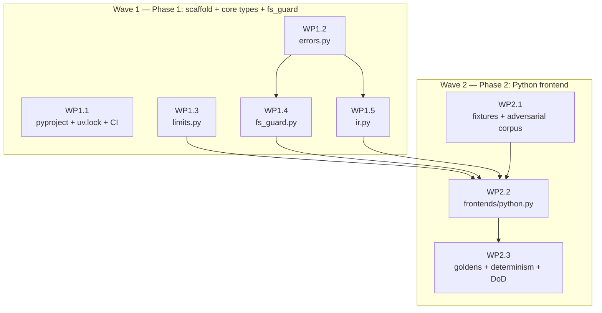

# EZ-Redis — Execution Plan for Phases 1–2

| Field | Value |
|---|---|
| **Plan** | Execution plan for PLAN.MD v2.0 Phases 1–2 (scaffold + core types + fs_guard; Python ast frontend) |
| **Date** | 2026-10-14 |
| **Status** | DRAFT — awaiting explicit user approval. No implementation has begun. |
| **Source of truth** | [PLAN.MD](./PLAN.MD) v2.0 (852 lines). This document narrows §G Phases 1–2 into work packages; where it refines PLAN.MD it says so explicitly. |
| **Evidence legend** | `[REPO]` repo-derived fact · `[EXT]` externally verified fact (source + retrieval date) · `[REC]` specialist recommendation · `[DECISION]` decided by user instruction (binding) · `[INF]` inference · `[UNKNOWN]` open question · `[LIMITATION]` disclosed gap |
| **Specialist consultations (this plan)** | 5 completed 2026-10-14, all PLAN-mode read-only: `python-pro` (IR finalization, frontend algorithm, packaging), `security-engineer` (fs_guard contract, threat model, CI hardening), `qa-expert` (golden protocol, fixtures, adversarial corpus, DoD), `mcp-developer` (SDK v2 wheel-verified facts, packaging, MCP-adjacent constraints), `api-designer` (error taxonomy, config groundwork, versioning). |
| **Independent verification (lead)** | Wilson CI math recomputed (§H.3 values confirmed); PyPI JSON API for 8 core deps (all match ledger); mcp 2.3.0 `requires_dist` inspected (pydantic>=2.12, httpx2>=2.10.0, mcp-types==2.3.0); `pydantic/httpx2` provenance verified (BSD-3-Clause, Tom Christie, active 2026-10-12); `uv_build` latest 0.13.1 + dynamic-version unsupported (uv #11718); CPython paren-depth behavior probed on 3.14 (10k/100k parens → fast `SyntaxError`); redis-py 8.1.0 introspected (pipeline/transaction idioms); msgspec 0.22.0 API probed (`encode(obj, *, order=None)`, `format(buf, indent=2)`, `json.schema()`); `uv sync --locked --frozen` flags confirmed on local uv 0.10.9. |

---

## 1. Goal and requirements

**Goal (outcome, not technology):** a reproducible, security-hardened package skeleton whose shared IR compiles, round-trips byte-identically, and emits a pinned JSON Schema; plus a Python frontend that turns redis-py-using source files into exact, evidence-carrying `FileFacts` — proven stable by a mechanical golden gate, safe against adversarial input, and green in CI on the interpreter matrix.

**Requirements (solution-free):**
- R1: `uv run pytest && uv run pyright && uv run ruff check` green in CI on Python 3.11 and 3.12+; `uv sync --locked --frozen` fails on lock drift. `[PLAN.MD §G Phase 1 DoD]`
- R2: IR round-trip byte-identical; JSON-Schema snapshot pinned to `ir_version`; any struct change without an `ir_version` bump fails CI. `[§E.1]`
- R3: fs_guard is the single filesystem choke point; every §I.2 invariant is a named passing test, including the 10k-iteration symlink race. `[§I.2]`
- R4: Python files → `FileFacts` with exact evidence at the §E.7 Python tiers; adversarial corpus (≥20 files) never crashes, never silently skips; ≥90% frontend module coverage. `[§G Phase 2 DoD]`
- R5: "Goldens stable" is mechanical: per-fixture goldens byte-compare green on every CI run, twice (in-process + cross-process), with regeneration requiring explicit intent. `[§G Phase 2 DoD; user-selected phrase]`
- R6: No `try/except` in entry points (Phase 1–2 have none); exactly one sanctioned per-file try inside the frontend adapter. `[§C]`
- R7: Resource limits hardcoded (not repo-configurable); oversize/deadline files are skipped-and-reported, never silent. `[§I.1]`
- R8: Phase 1 must not preclude Phases 5–9: error taxonomy + exit table complete now; stderr-only diagnostics; no network imports in core; fs_guard root-agnostic. `[§E.4, §I.6, §I.7]`

**Invariants (mechanically testable):**
- I1: `FileFacts` is a pure function of (path, source bytes, interpreter version) — no env, no clock, no I/O below the adapter. `[REC: python-pro]`
- I2: `decode(encode(x)) == x` and encode output byte-stable across the CI matrix. `[REC: python-pro]`
- I3: No `try/except` anywhere in `src/ez_redis/**` except the single per-file protected region in `frontends/python.py` (AST-verified). `[REC: python-pro]`
- I4: No module outside `fs_guard.py` uses `open`/`Path.write_text`/`shutil`/`os.remove`/`os.stat`-style file APIs (AST-verified). `[§I.2]`
- I5: `frontends/python.py` imports internal modules from exactly `{ir, errors, limits, fs_guard}` — never the reverse. `[REC: python-pro]`
- I6: Unknown → `known_op=False` / `kind="unknown"` / `resolved=False` — never a guess; every downgrade increments `unresolved_count`. `[§E.7 honesty rule]`
- I7: Skipped/deadline files produce a degenerate `FileFacts` (`content_hash=""`, diagnostic with machine-readable reason) — reported, never silent. `[§I.1]`
- I8: IR length caps: `snippet ≤ 5×200`, `Arg.value ≤ 200`, `KeyPart.value ≤ 200`, `ParseDiagnostic.message ≤ 300`. `[REC: python-pro]`
- I9: No `type: ignore` / no `Any` in `src/` (pyright strict is the gate). `[REC: python-pro]`
- I10: `sys.setrecursionlimit` is never raised anywhere (raising converts RecursionError into C-stack segfault risk). `[REC: security-engineer]`
- I11: Writes never modify an existing inode (replace-only); same-directory temp; data fsync before rename, dir fsync after. `[REC: security-engineer]`
- I12: No absolute paths and no wall-clock timestamps in any golden file. `[REC: qa-expert]`

---

## 2. Skills and Docs Ledger

**Skills loaded:** `backend-development` (lead). Specialists read their domain references (`backend-security.md`, `backend-testing.md`, `backend-code-quality.md`) as applicable.

**Docs Ledger (versions verified 2026-10-14 via PyPI JSON API unless noted; specialists re-verified live this session):**

| Library / tool | Version in use | Latest verified | Source | Findings |
|---|---|---|---|---|
| Python | ≥3.11 floor; CI matrix 3.11 + 3.12 | 3.14.6 local | local + prior pyproject `[REPO]` | Code only against surfaces stable 3.11→3.14: `ast.Constant`, `JoinedStr/FormattedValue`, `BinOp(Add/Mod)`, `Call/Attribute/Name/With`; never `ast.Str/Num/NameConstant` `[REC: python-pro]` |
| `uv` | 0.10.9 local | 0.10.9 | local `[EXT]` | `uv sync --locked --frozen` flags verified; extras not installed by default (only with `--extra`/`--all-extras`) `[EXT: docs.astral.sh/uv/reference/cli/#uv-sync]` |
| `uv_build` | `>=0.13.1,<0.14` | 0.13.1 | pypi.org/pypi/uv-build/json `[EXT]` | **Prior repo's `uv_build>=0.8,<0.9` pin is stale** — refresh. **Does NOT support `dynamic = ["version"]`** (uv issue #11718) — version must be static in pyproject `[EXT: docs.astral.sh/uv/concepts/build-backend/, retrieved 2026-10-14]` |
| `msgspec` | `==0.22.0` exact | 0.22.0 | pypi.org/pypi/msgspec/json `[EXT]` | API probed: `encode(obj, *, order=None)` (no `indent=` param — use `msgspec.json.format(buf, indent=2)` for pretty goldens); `json.schema()` works; declaration-order serialization; cp314 wheels exist (21) `[EXT: probed on this machine]` |
| `tree-sitter` + `tree-sitter-language-pack` | **deferred to Phase 4** | 0.26.0 / 1.22.1 | pypi.org `[EXT]` | Not Phase 1–2 deps (python-pro + qa-expert concur: fewer a-priori pins; wheel floor doesn't gate CI until imported) |
| `typer` + `rich` | **deferred to Phase 5** | 0.27.3 / 15.0.0 | pypi.org `[EXT]` | Not Phase 1–2 deps (no CLI until Phase 5) |
| `platformdirs` | `>=4.13` | 4.13.0 | pypi.org `[EXT]` | Needed Phase 1 (audit sink location) |
| `mcp` | `[mcp]` extra `>=2.3,<3`, declared Phase 1 | 2.3.0 | pypi.org/pypi/mcp/json `[EXT]` | `requires_dist` inspected: `pydantic>=2.12.0`, `mcp-types==2.3.0`, **`httpx2>=2.10.0`**, `pyjwt[crypto]>=2.10.1`, `opentelemetry-api>=1.28.0`, `uvicorn`, `starlette`, `sse-starlette`, `jsonschema>=4.20` `[EXT: wheel METADATA, mcp-developer consult]` |
| `httpx2` | (transitive via `[mcp]`) | 2.13.1 | pypi.org/pypi/httpx2/json `[EXT]` | **Provenance RESOLVED** (upgrades PLAN.MD §D `[UNKNOWN]`): `github.com/pydantic/httpx2`, BSD-3-Clause, author Tom Christie (httpx author), 1550 stars, pushed 2026-10-12. Gate passes; record in ledger `[EXT: api.github.com/repos/pydantic/httpx2, retrieved 2026-10-14]` |
| `redis` (redis-py) | **deferred to Phase 8** | 8.1.0 | pypi.org `[EXT]` | Introspected this session for fixture design only: `pipeline(transaction=True)` default, `.multi()`, `.execute()`, `StrictRedis`, `asyncio.Redis`, `ConnectionPool(max_connections=)` all confirmed |
| dev group | pytest 8.4.2, pytest-cov 7.1.0, ruff 0.17.0, pyright 1.1.414, hypothesis, pre-commit, pip-audit, **import-linter (added — PLAN.MD §D omits it while §I.7 + Phase 1 DoD mandate it)** | current | uv pip compile resolved for py3.11 `[EXT]` | Resolution verified clean this session |
| `structlog` | dropped | — | — | stdlib logging; `logging_setup.py` lands Phase 1 (mcp-developer: stderr-only must be wired Phase 1, not Phase 6) |
| `langgraph` | out of scope | — | — | Phase 10 deferred per PLAN.MD |

**Rejected alternatives:** per-language native ASTs; LSP-based analysis; regex-only v1; FastMCP 4.x; pydantic in core; findings-level caching (v2); hatchling backend for dynamic versioning (would abandon uv_build for a plugin — not worth it; static version + equality test instead) `[REC: api-designer, overridden by uv_build reality]`.

---

## 3. Architecture (Phase 1–2 slice)



**Pure core vs effectful shell:** `ir.py`, `errors.py`, `limits.py` are pure (no I/O, no clock, no env). `fs_guard.py` is the only filesystem API in effectful modules. `frontends/python.py` is two pure functions + one thin adapter — the adapter is the only effectful seam and holds the one sanctioned per-file try. No entry point exists in Phase 1–2 (no `__main__`, no console script wiring beyond the packaging stub), so the "no try/except in entry points" rule is upheld trivially.

**Import direction (enforced by test):** `frontends/python.py → {ir, errors, limits, fs_guard}`; nothing imports frontends; nothing imports fs_guard except the frontend adapter and (Phase 5+) services.

---

## 4. Contracts (exact)

### 4.1 IR structs — `src/ez_redis/ir.py` (python-pro finalization; 6 revisions to PLAN.MD §E.1, all additive/narrowing pre-release)

Six gaps in the §E.1 sketch would have blocked Phase 2; since IR is not yet shipped, fix them in v1 rather than carrying debt:

| §E.1 gap | Revision (binding for Phase 1) | Reason |
|---|---|---|
| `FileFacts` has no `ttls` / `structures` fields | Add both | `TTLSetting`/`DataStructure` structs exist with no owner (§E.7 promises *exact* TTL extraction for Python — unshippable without the field) |
| `RedisCall` has no receiver/client/pipeline link | Add `receiver: str \| None`, `client_id: str \| None`, `pipeline_id: str \| None` | Per-caller facts unusable for `connections` rules and pipeline joins otherwise |
| `ClientConstruction` has no `id` | Add `id: str` | `ConnectionFact.client_id` references a nonexistent id |
| `RedisCall.key_id: str` (required) | `key_id: str \| None` | Attribute/pattern-free ops (`SCAN`, `PING`, `EVAL` without keys) have no key |
| `TTLSetting.value_expr_id` — no expression table exists to point at | Replace with `value_source_text: str \| None` | No dangling reference; source text IS the payload for non-literal TTLs |
| `Arg` has no positional index | Add `index: int` | Rules must distinguish `SETEX(key, ttl, value)` operand roles |

Final struct sketch (msgspec frozen, kw_only; field names/types binding):

```python
IR_VERSION: Final[Literal["1"]] = "1"

Evidence            { path: str,            # repo-relative, posix separators
                      line: int,            # 1-based
                      col: int,             # 0-based
                      end_line: int,
                      snippet: str,         # ≤5 lines × 200 chars/line
                      confidence: "exact" | "approximate" | "unknown" }

Arg                 { index: int,           # 0-based operand index at the call site
                      kind: "literal" | "key_ref" | "expr" | "unknown",
                      value: str,           # ≤200 chars: literal repr or source text
                      key_id: str | None }  # set iff kind == "key_ref"

KeyPart             { kind: "literal" | "interpolation" | "unknown",
                      value: str,           # literal text; source text for interpolation
                      var_id: str | None }  # f"{scope}::{name}" when plain Name; None otherwise

KeyExpression       { id: str,              # "k{n}", doc order
                      parts: tuple[KeyPart, ...],
                      resolved: bool,       # True only when every part is literal/interpolation
                      evidence: Evidence }

ClientConstruction  { id: str,              # "k{n}", doc order
                      client_kind: "redis-py" | "unknown",   # Python column: only these two
                      name: str,            # binding target source text, e.g. "self.redis"
                      scope_path: tuple[str, ...],
                      evidence: Evidence }

ConnectionFact      { client_id: str,       # → ClientConstruction.id
                      pool: bool, max_connections: int | None,
                      decode_responses: bool | None, db: int | None,
                      url_has_credentials: bool,   # presence only — credential text NEVER stored
                      evidence: Evidence }

RedisCall           { call_id: str,         # "c{n}", doc order (referenced by edges/pipelines)
                      op: str,              # OPEN-ENDED, upper-cased redis command name
                      known_op: bool,
                      key_id: str | None,
                      receiver: str | None, # source text e.g. "r", "self.redis"
                      client_id: str | None,
                      pipeline_id: str | None,
                      args: tuple[Arg, ...],
                      evidence: Evidence }

TTLSetting          { call_id: str,         # join to the setting call
                      seconds: int | None,  # normalized; None when non-literal (no guessing)
                      unit: "s" | "ms",
                      value_source_text: str | None,
                      source: "setex" | "expire" | "pexpire" | "psetex" | "set-ex" | "set-px" | "unknown",
                      evidence: Evidence }

DataStructure       { kind: "string" | "hash" | "list" | "set" | "zset" | "stream" | "unknown",
                      key_id: str, evidence: Evidence }   # derived from command-family table

InvalidationEdge    { from_call_id: str, to_call_id: str | None,   # None in Phase 2 (cross-file = Phase 3)
                      seq: int,             # doc-order index of the invalidating call in the file
                      key_id: str,
                      kind: "del" | "expire" | "publish" | "unlink" | "unknown",
                      evidence: Evidence }

PipelineBlock       { id: str,              # "p{n}", doc order
                      calls: tuple[str, ...],   # call_ids in doc order
                      kind: "pipeline" | "transaction" | "pipeline_transaction",
                      executed: bool | None,    # True iff .execute() statically inside block; None = unknown
                      evidence: Evidence }

ScriptInvocation    { id: str,
                      sha_or_source_hash: str,  # "source:<sha256hex[:16]>" literal; "sha:<declared>" EVALSHA
                      ops_hint: tuple[str, ...],    # () in Phase 2 — Lua bodies opaque
                      keys_arg_resolved: bool,      # numkeys literal int == len(captured key args)
                      evidence: Evidence }

PubSubFact          { channel_expr: KeyExpression,   # nested-in-struct, no top-level id
                      direction: "pub" | "sub", evidence: Evidence }

ParseDiagnostic     { path: str, language: "python",   # widened Phase 4
                      severity: "error" | "recoverable",
                      message: str,         # ≤300 chars
                      span: tuple[int, int] | None }

FileFacts           { path: str, language: "python",
                      content_hash: str,    # sha256hex of full file bytes; "" iff skipped_unparsed
                      parse_ok: bool,
                      diagnostics: tuple[ParseDiagnostic, ...],
                      calls: tuple[RedisCall, ...], keys: tuple[KeyExpression, ...],
                      ttls: tuple[TTLSetting, ...],          # added
                      structures: tuple[DataStructure, ...], # added
                      constructions: tuple[ClientConstruction, ...],
                      connections: tuple[ConnectionFact, ...],
                      invalidations: tuple[InvalidationEdge, ...],
                      pipelines: tuple[PipelineBlock, ...],
                      scripts: tuple[ScriptInvocation, ...],
                      pubsub: tuple[PubSubFact, ...],
                      unresolved_count: int }

Finding             { finding_id: str,      # sha256(rule_id|path|line|col|snippet)[0:12]
                      rule_id: str, rule_version: str,
                      severity: "info" | "low" | "medium" | "high",
                      title: str, message: str, evidence: Evidence,
                      config_source: "repo" | "user" | "default",
                      category: str,        # enum per §E.2
                      confidence: "exact" | "approximate" | "unknown",
                      fix_hint: str | None, doc_ref: str | None }

AnalysisResult      { tool_version: str, ir_version: Literal["1"],
                      grammar_versions: tuple[tuple[str, str], ...],
                      config_hash: str, generated_at: str, partial: bool,
                      files: tuple[FileFacts, ...], findings: tuple[Finding, ...] }
```

**`unresolved_count` formula (exact):** `#{p ∈ keys.parts : p.kind == "unknown"} + #{c ∈ calls : ¬c.known_op} + #{s ∈ scripts : ¬s.keys_arg_resolved} + depth-aborts + deadline-skips (1 each)`. Monotone evidence of diminished confidence; reported per repo as `unresolved_rate` in Phase 3/5.

**Key-part var_ids (Phase 2 contract):** same-module, flow-insensitive, single-level string-expression binding: `name ← str-literal | f-string | % | .format | concat` in any enclosing scope, last-writer-wins. When resolved, the `interpolation` part expands to its parts and `resolved = True`; when absent/non-translatable, the part stays `interpolation` with `var_id = f"{scope}::{name}"` for Phase 3's worklist pass. `unknown` kind is reserved for constructs we cannot even name (attribute chains, subscript keys, `chr(0x75)`): **never guessed**.

**Ordering determinism:** every tuple is sorted or doc-order-assigned — calls in AST visit order; `keys`, `ttls`, `structures`, `invalidations`, `pipelines`, `scripts`, `pubsub` in first-encounter order; no hash-ordered or set-ordered field anywhere in the IR. (QA adds: goldens normalize ordering by `(line, col, op)` where two orderings could legitimately differ — see §6.1 N4.)

**Serialization:** `msgspec.json.encode` (declaration-order fields) → `msgspec.json.format(buf, indent=2)` for human-reviewable golden diffs (probed: `encode` has no `indent=` param; `format` does) → trailing newline. Decode with default strict mode: unknown/missing fields raise → `ir_version` drift fails closed. Round-trip invariant: `decode(encode(x)) == x` (no float, no dict, no ambiguous types). Schema emission: `msgspec.json.schema(...)` snapshot pinned to `ir_version`; **pin rule mechanical: any struct change that changes schema bytes must carry an `IR_VERSION` bump in the same PR** (enforced by the golden failing). Msgpack not used in Phase 1–2. `Finding` is defined in Phase 1 (it is part of `AnalysisResult`; §E.2 has no TBD fields; deferral would churn the Phase 5 snapshot) — derivation logic is Phase 5; the struct carries `confidence: "unknown"` default and a `test_finding_id_formula` pins the ID formula on a fixed input vector. `[REC: api-designer]`

**Versioning axes (four, never conflated):** `tool_version` (package semver, single source `__init__.py.__version__`); `ir_version` (bump on any field change; readers accept current and previous, N−2 rejected); `grammar_versions` (per AnalysisResult and per cached entry — for Python: `(("python-ast", "3.nn"),)` one entry per run, NOT per-file, so goldens stay cross-version-comparable); `config_hash` (canonical hash of resolved config — Phase 5; Phase 1 goldens carry a constant placeholder value; the schema snapshot is unaffected by value wiring). `[REC: python-pro + api-designer]`

**Versioning single source:** `__version__` in `src/ez_redis/__init__.py` is the single source; pyproject declares `version = "0.1.0"` statically with a conformance test asserting equality (uv_build does not support `dynamic = ["version"]` — uv #11718 `[EXT]`; the api-designer's hatchling-dynamic recommendation is overridden by the uv_build reality; the equality test is the accepted fallback). `IR_VERSION` lives in `ir.py` beside the structs; `AnalysisResult.ir_version` typed `Literal["1"]`; `test_ir_version_constant_matches_struct_field` asserts agreement.

### 4.2 Error taxonomy — `src/ez_redis/errors.py` (api-designer contract)

One module owns three artifacts: (1) the code set, (2) the typed classes, (3) the exit-code map. Exactly one place a code/exit mapping can live; exactly one golden test guarding it.

**Stable string codes (7, closed set):**

```python
CODE_ANALYSIS_CONFIG:     Final = "analysis_config_error"     # exit 2 — Phase 5 raiser
CODE_ANALYSIS_PARSE:      Final = "analysis_parse_error"      # exit 3 — reserved (never raised by Phase 2)
CODE_PATH_OUTSIDE_ROOT:   Final = "path_outside_root"         # exit 2 — raised Phase 1 (fs_guard)
CODE_REDIS_ACCESS:        Final = "redis_access_error"        # exit 4 — Phase 8 raiser
CODE_READ_ONLY_VIOLATION: Final = "read_only_violation"       # exit 5 — Phase 7 raiser
CODE_JEV_UNAVAILABLE:     Final = "jev_unavailable"           # exit 6 — Phase 9 raiser
CODE_PATCH_VALIDATION:    Final = "patch_validation_error"    # exit 3 — Phase 5 raiser
```

**Classes — functional, zero logic:** base `EzRedisError(Exception)` carrying `code: ClassVar[str]` (base code `"ez_redis_error"`, never raised directly), `message: str` (human-only, never parsed by surfaces), `details: Mapping[str, JSONValue]` (str-keyed, JSON-safe leaves only — no repo-derived URLs). Six flat subclasses; mappers key on `.code` (via pure `code_for(exc) -> str`), not isinstance chains:

- `AnalysisError(EzRedisError)` with `subkind: Literal["config", "parse"]` — code resolved via frozen `_SUBKIND_TO_CODE` lookup. Subkind-not-two-classes rationale: §E.4 maps config→2 and parse→3, so the table keys on the subkind; a separate `ConfigError` class would add an 8th row with no semantic gain. `[REC: api-designer]`
- `PathOutsideRootError` — the only Phase 1–raiser (fs_guard); `details` = guard audit fields (`rel`, `decision`, `reason`).
- `RedisAccessError`, `ReadOnlyViolationError`, `JevUnavailableError`, `PatchValidationError` — **defined Phase 1, first raised Phases 5/7/8/9** (taxonomy completeness makes Phase 5–6 conformance free).

**Exit table as data (§E.4 verbatim, frozen mapping):**

```python
EXIT_BY_CODE: Final[Mapping[str, int]] = {
    "analysis_config_error": 2, "analysis_parse_error": 3,
    "path_outside_root": 2, "redis_access_error": 4,
    "read_only_violation": 5, "jev_unavailable": 6, "patch_validation_error": 3,
}
RETRYABLE_BY_CODE: Final[Mapping[str, bool]] = {...}   # same module, same golden test
```

`retryable` is **mapper-owned** (a `CODE → bool` table beside `EXIT_BY_CODE`), not exception-carried — §E.5 pins `retryable:false` for `redis_access_error` only, and that is surface semantics. `JevUnavailableError`'s "exit 6 only when Jev explicitly required; default fallback + 0" gating is **service-layer logic, never in errors.py**; the table maps unconditionally and stays pure data.

**Golden test** `tests/unit/test_errors.py::test_exit_code_table_is_golden`: (1) element-wise equality against committed literals; (2) `set(EXIT_BY_CODE) == set(ALL_CODES)` — 7 codes → 7 rows, total, no orphans; (3) values ⊆ {0, 2, 3, 4, 5, 6} (1 unassigned/reserved; typer's generic-exception exit 1 is a Phase 5 mapping concern — every `EzRedisError` must be mapped explicitly at the CLI main callback, never left to typer's default handler); (4) subkind completeness: both `AnalysisError` subkinds resolve via `code_for` to table rows; (5) `RETRYABLE_BY_CODE` keys mirror the code set.

**Parse failure: exception or data?** **Purely data in Phase 2 — parse failure is NEVER an exception on the analysis path.** Evidence: §E.5 `analyze_project` errors column ("parse failure is *data* (partial facts + `unresolved_rate`), never a call failure"); §C sanctions exactly one per-file try in frontend adapters; `FileFacts.parse_ok=false` + `diagnostics` is the channel. `AnalysisError(subkind="parse")` stays **reserved** for call-level analysis failure (the analyze call itself cannot produce a report — Phase 5 orchestration failures), never for a single file's SyntaxError. Phase 2 ships zero new codes and never raises `AnalysisError`. `[REC: api-designer]`

**Config groundwork (§I.3):** **defer config.py entirely to Phase 5** — nobody consumes config in Phase 1–2 (the §E.4 `analyze()` signature takes globs/max_files/severity as kwargs, not a config object; the Phase 2 frontend has no config parameter), and shipping an untrusted-TOML surface before its security invariants exist (TOML-bomb caps, unknown-key hard-fail, trust-class semantics) would create a second config surface Phase 5 would have to adopt or break. Phase 1 ships only: the `ConfigTrustClass` Literal enum + `ERROR_UNKNOWN_CONFIG_KEY` code reservation + IR's `config_source`/`config_hash` fields (schema-level provenance, enforces nothing yet) with round-trip tests. The ez-redis.toml schema sketch (repo: `include_globs`/`exclude_globs`/`[rules.EZxxx] enable=true-only, severity_floor=raise-only`; trusted surface: severity overrides, rule disable, `--allow-write`, redis target, jev keys) is recorded in PLAN.MD as planning material, implemented Phase 5. `[REC: api-designer + security-engineer concur]`

### 4.3 fs_guard — `src/ez_redis/fs_guard.py` (security-engineer contract)

```python
def safe_open(root: Path, rel: str, mode: Literal["r", "rb", "x", "xb"],
              *, allow_symlink: bool = False, force: bool = False) -> int
def safe_write(root: Path, rel: str, data: bytes, *, force: bool = False) -> None
def root_id(root: Path) -> str          # sha256(realpath(root))[:16], for audit + later cache keying
def stat_size(root: Path, rel: str) -> int      # no-follow size probe (frontend pre-check)
def read_bytes(root: Path, rel: str, *, max_bytes: int) -> bytes   # no-follow, byte-capped
```

`rel` is UTF-8 POSIX-forward-slash, ≤4096 bytes. Returns an open fd on success; raises typed errors from `errors.py` with stable codes (`E_GUARD_REL_ABS`, `E_GUARD_TRAVERSAL`, `E_GUARD_SYMLINK`, `E_GUARD_GIT`, `E_GUARD_EXISTS`, `E_GUARD_ROOT_CHANGED`, `E_GUARD_WEAK_PLATFORM`) — never raw `OSError` leaking.

**Invariants (each one a §I.2 test):**
1. `rel` must be relative, already-normalized, no `..` after `PurePosixPath` normalization, no empty/`.` components, no drive letters/UNC, NUL/byte-order chars rejected. **Reject, never clean** — cleaning converts attacker input into a different path; rejection keeps the audit trail meaningful.
2. **Root pinning, race-free sequencing:** `realpath(root)` → `dfd = os.open(root, O_RDONLY|O_DIRECTORY)` → `fstat(dfd)` must equal `os.stat(root)` in `(st_dev, st_ino)`; mismatch → `E_GUARD_ROOT_CHANGED`. After this the fd pins the verified object. Rotate `dfd` per top-level call (no instance cache).
3. **Per-component no-follow walk** from `dfd`: for each component, `os.stat(comp, dir_fd=cur, follow_symlinks=False)`; symlink → reject (or branch-B re-verify); directory → `cur = os.open(comp, O_RDONLY|os.O_NOFOLLOW|os.O_DIRECTORY, dir_fd=cur)`. `O_NOFOLLOW` on the *open* (not just the stat) closes the stat→open swap race (CWE-367). **Empirically verified on darwin arm64 (this machine):** per-component directory opens with `O_NOFOLLOW` succeed on real directories; only the final-component symlink case diverges (branch below).
4. **macOS branch is real and explicit (`_DARWIN_FINAL_SYMLINK`):** darwin exposes `os.O_NOFOLLOW` (256) as an **alias of `O_SYMLINK`** (2097152) with different semantics — with `O_NOFOLLOW`, opening a final-component symlink *succeeds and opens the symlink itself*; a write through that fd retargets the link while readers of the target see the old inode (verified by probe: wrote `X` through the link fd; target still read `ORIG`). Consequences encoded: **writes** — Linux `O_NOFOLLOW→ELOOP` on symlink final; macOS `O_NOFOLLOW` opens the link then `O_CREAT|O_EXCL` fails `EEXIST` (link exists), and `safe_write`'s temp name never exists, so the final `os.replace` replaces the directory entry (symlink replaced, remote target untouched) — still, after any final-component open on darwin, `fstat` + `S_ISLNK(lstat(..., follow_symlinks=False))` check → reject `E_GUARD_SYMLINK` if link; never write through an `O_SYMLINK` fd. **Reads** — Linux: `ELOOP` (errno 62) = symlink detected; darwin: open may return an fd to the link itself → open with `O_NOFOLLOW`, then `os.fstat` + separately `os.stat(final, dir_fd=cur, follow_symlinks=False)`; disagreement (`S_ISLNK` or `st_ino` divergence) treated exactly like Linux's `ELOOP`: reject unless `allow_symlink`. Mirror test via `pytest.skipif(sys.platform != "darwin")`.
5. **Branch B — `allow_symlink=True` re-verification:** reject-then-verify-then-open is itself raced unless verification is structural. Implement: readlink (final component relative to its dir fd), then **walk the target through the guard itself** (recursive, depth cap 40 ≥ kernel MAXSYMLINKS) from `root` with no-follow components. If the walk terminates inside the pinned root, the final fd is provably in-root regardless of mid-flight link swaps. Out-of-root target → `E_GUARD_SYMLINK`. Reads with `allow_symlink=False` never dereference links at all.
6. **Writes:** mode `x`/`xb` = `O_WRONLY|O_CREAT|O_EXCL|O_NOFOLLOW`, perm `0o600`, **no-clobber**. Overwrite (`force=True`) is not `O_TRUNC` — it is `safe_write`: temp file created `O_EXCL` **in the same directory** (mandatory: `os.replace` across filesystems is unsupported rename → copy = torn window), `os.fsync(fd)` → close → `os.replace(src_dir_fd=cur, dst_dir_fd=cur)` → **directory fsync** (verified working on darwin arm64; skip on Windows, documented). Order: data fsync **before** rename, dir fsync **after**. Atomic per POSIX within a filesystem; torn entries impossible by construction (this is also the §E.3 cache-write primitive — Phase 5 reuses unchanged).
7. **`force` never overrides:** symlink final target, symlinked intermediates, anything named/under `.git`. `force` only waives `E_GUARD_EXISTS`.
8. **`.git` rejection is name-based *and* structural:** forbid any `git`/`.git` component in `rel`. Hardlink aliasing into `.git` cannot matter because **the guard never modifies an existing inode** (writes are replace-based → new inode; hardlink aliasing dies with the replace). Documented in the module docstring; no `st_nlink` check.
9. **Audit log, Phase 1 shape** — one JSON line per call, appended via raw `os.open(sink, O_WRONLY|O_CREAT|O_APPEND|os.O_NOFOLLOW, 0o600)`:
   `{"schema": 1, "ts": <iso8601>, "op": "open"|"write", "root_id": "<sha256:16>", "rel": "<rel, ≤4096B>", "mode": "...", "decision": "allow"|"reject"|"allow_symlink"|"weak", "reason": "<stable code, e.g. E_GUARD_TRAVERSAL>", "errno": <int|null>}`
   `root_id` only — no absolute paths in the log, no repo-derived free text beyond `rel`. **Sink:** `platformdirs.user_config_dir("ez-redis")/fs-audit.jsonl`, 0600, created 0600; sink opens use `O_NOFOLLOW` (a swapped audit log must fail, not be followed — verified the `O_NOFOLLOW`+`O_APPEND` combo refuses symlink creation on darwin). **Phase 1 does now:** record shape v1, append-only, 0600, no-follow, config-dir placement, audit-before-return (a failed audit write on an *allow* must abort the open — audit failure = operation did not happen). **Phase 1 defers (per plan):** `prev_hash` chain fields, rotation, tamper-detection test (`test_audit_hash_chain_detects_truncation`, Phase 8), fork-tamper evidence; schema bump path documented in the module (`schema: 2` adds `prev_hash`).
10. **Weak-platform rule (Windows):** no `O_NOFOLLOW`/`dir_fd` → per §I.2 fallback = lstat-then-open, decision recorded as `"weak"`, module docstring documents the residual (CWE-59 remains exploitable on Windows in the check→open window); v1 platform floor is Linux/macOS per §J Q8.
11. **No other file API in effectful modules** — enforced by the AST test (§6.4); `errors.py`/`limits.py`/`ir.py` are pure.

**Resource-limits verdict (security-engineer, measured):** all six §I.1 constants confirmed sane for Phase 2's ast frontend — measured 760 KB/320k-node file parses + walks in ~0.35 s ⇒ 5 s per-file has ≥10× headroom; 1 MiB cap covers adversarial corpora; 20k files / 512 MiB keep repo-scale DoS bounded; 600 s total generous for CI. **Proposed addition (needs user approval): `max_dir_depth=64`** as a 7th hardcoded constant — `max_depth=200` must mean *AST node depth in the frontend's iterative walk*; the zipbomb/cachedir-tree test needs its own knob to stay crisp.

**Verified parser-DoS specifics (Python 3.11.15 and 3.14.6, this machine, 2026-10-14):**
- `ast.parse("("*n + ")"*n)`: **n=200 parses, n=201 → `SyntaxError: too many nested parentheses`** — identical on 3.11/3.13/3.14 (CPython paren-depth guard ships in 3.11 too). A *fast SyntaxError*, not a DoS vector on our floor.
- **The real crash vectors are below the paren guard:** `"a" + "+a"*500000 → RecursionError` (both versions); `"-"*200000 + "1" → MemoryError` (both); chained attributes/subscripts/boolops of 20k+ **parse successfully** and yield 40k+-deep trees — `depth≤200` does *not* catch them, and any recursive visitor blows the 1000 recursion limit (or the C stack).
- Implications encoded as invariants: frontend traversal is **iterative only** (new test `test_deep_attr_chain_no_visitor_recursion`); the sanctioned per-file try must catch `RecursionError` and scoped `MemoryError` alongside `SyntaxError` and convert to `ParseDiagnostic(severity="recoverable")` + partial facts; **never** raise `sys.setrecursionlimit`; f-string/kwargs adversarial shapes of 100k+ scale parsed fine on both versions (no special handling beyond size cap + deadline + paren pre-scan).

### 4.4 ResourceLimits — `src/ez_redis/limits.py`

Frozen msgspec struct; **defaults are the hardcoded §I.1 values**; the constructor accepts explicit overrides plumbed only from code/callers (never from repo TOML — no config key exists, and `test_unknown_config_key_hard_error` proves it in Phase 5). This is the sanctioned test seam: the deadline test constructs `ResourceLimits(max_parse_seconds_per_file=<tiny>)` and parses a genuinely slow fixture — no monkeypatching a frozen struct, no sleeps, monotonic clock, deterministic in *trigger*. `[REC: qa-expert, resolves the §I.1 tension]`

```python
ResourceLimits { max_file_bytes: int = 1_048_576,        # 1 MiB
                 max_depth: int = 200,                    # AST node depth (iterative walk gauge)
                 max_dir_depth: int = 64,                 # file-tree depth (zipbomb) — pending user approval
                 max_files: int = 20_000,
                 max_total_bytes: int = 536_870_912,      # 512 MiB
                 max_parse_seconds_per_file: float = 5.0,
                 max_total_seconds: float = 600.0,
                 max_facts_per_file: int = 10_000 }       # pending user approval (see §9 Q1)
```

`SkippedReason: Literal["oversize", "parse_deadline_exceeded"]` lives here (a limit-trigger, not a user-facing analysis error). `ParseDeadlineExceeded` raised from a `signal.setitimer(ITIMER_REAL)` handler (POSIX; degrades to no-deadline elsewhere with a documented diagnostic — v1 platform floor is POSIX per §J Q8).

### 4.5 MCP-adjacent Phase 1 constraints (mcp-developer)

- **stderr-only diagnostics wired in Phase 1, not Phase 6:** new `src/ez_redis/logging_setup.py` — `configure_logging(*, verbose: bool = False)` with `logging.basicConfig(..., stream=sys.stderr, force=True)` (explicit — never trust a later caller's default; rich/typer arrive Phase 5 and default to stdout). Test `test_configure_logging_never_stdout`: configure, emit a record, assert `capsys` stdout empty and stderr carries the record. Every later surface calls `configure_logging()` and never instantiates its own handler. (Bonus verified fact: while serving, the SDK itself redirects fd 1 to stderr — defense-in-depth, not license to print to stdout; the CLI runs without the stdio server so its diagnostics must already be stderr-clean.)
- **import-linter contract created in Phase 1, inverted direction:** forbid network modules (`urllib`, `http.client`, `socket`, `httpx`, `httpx2`, `requests`) across the whole `src/ez_redis` package — green from Phase 1 and stays meaningful forever; each adapter PR (inspect Phase 8, jev Phase 9) adds its `ignore_imports` entries in the same commit. Strictly stronger than §I.7's exception-listing (default-deny beats exception-listing). The fs-API ban itself stays the AST-scan pytest (import-linter can't see builtins/attribute calls). **`import-linter` added to the dev group** (PLAN.MD §D omits it while §I.7 + Phase 1 DoD mandate it).
- **`[mcp]` extra declared at Phase 1** with the pinned range `mcp>=2.3,<3`: `uv sync --locked --frozen` fails on pyproject/lock drift so the extra and its lock entries land in the same Phase 1 commit; extras are not installed by default (verified uv semantics), so ordinary dev/test environments don't pull mcp; Phases 2–5 never touch the dependency graph again; the Phase 6 PR becomes pure code. CI audit line amended to `uv sync --locked --frozen --all-extras` before pip-audit so locked-but-never-installed deps are audited from Phase 1 (a CVE in pydantic/starlette/httpx2 surfaces in Phase 1 CI, not Phase 6). Empty-extra alternative rejected (`pip install ez-redis[mcp]` would be a silent no-op — a false-promise extra). `[REC: mcp-developer]`
- **httpx2 provenance gate pulled into Phase 1 DoD:** §I.7 says "verify before `[jev]`/`[mcp]` extras are locked" — the lead has now verified it (`pydantic/httpx2`, BSD-3-Clause, Tom Christie, active); recorded in the ledger above; the `[UNKNOWN]` is converted to a verified fact before anything is committed. Extend §I.7's auto-merge disablement from `tree-sitter-*` to the `[mcp]` extra group (Renovate/Dependabot bumps of not-yet-consumed packages cannot auto-land).
- **Console script declared at Phase 1, pointing at a fail-loud stub; subcommands deferred:** `[project.scripts] ez-redis = "ez_redis.cli:main"` with a 4-line `cli.py` stub (stderr message "ez-redis CLI ships in Phase 5; this install exposes the entry point only.", `raise SystemExit(2)` — inside the §E.4 taxonomy from day one). Entry points are created at install time and validated only at runtime; a missing target would turn every early invocation into a raw `ModuleNotFoundError`. The stub validates console-script plumbing in Phase 1 CI (golden assertion: exit code 2, stderr message, empty stdout) and locks the user-visible binary name early. Do **not** declare subcommand-level stubs until their phases. `[REC: mcp-developer]`
- **`ez-redis init` needs nothing in Phase 1** (Phase 5); passive guarantees already provided: `safe_open`'s `O_EXCL` means init physically cannot clobber an existing `.mcp.json`; nothing in Phase 1 grants any write-enabling path. Shared constant home: `src/ez_redis/mcp_config.py`, authored Phase 5 alongside `services.init()`; Phase 6 consumes read-only. Snippet sketch (Phase 5): `{"mcpServers": {"ez-redis": {"command": "ez-redis", "args": ["mcp", "--root", "<abs root>"]}}}` — root rides startup argv (never a tool argument), `env` deliberately absent (inherit user env; never bake credentials into a repo-committed file). Phase 6 adds `test_init_snippet_is_executable` (parse printed snippet → spawn server → `tools/list` returns 4 tools).

**SDK v2 facts verified at wheel level (mcp-developer, 2026-10-14)** — all PLAN.MD §E.5 assertions confirmed, plus two corrections folded into later-phase scope (not Phase 1–2 work, recorded so Phase 6 inherits them):
1. **ToolError prefix (material):** the SDK wrapper prepends `"Error executing tool <name>: "` to ToolError messages — the §E.5 "message is the single-line JSON error object" will arrive on the wire as `Error executing tool analyze_project: {"code": …}`. Phase 6 resolution: ratify the prefix as part of the contract (deterministic, golden-tested `test_tool_error_wire_format`), keeping the high-level API.
2. **"initialize handshake" wording obsolete:** under protocol 2026-07-28 there is no initialize handshake (removed with sessions/ping); `Client(mcp)` probes `server/discover` with legacy fallback. Phase 6 tests assert protocol negotiation, not "initialize handshake".
Also verified: `MCPServer` export + FastMCP raising stub; stdio via `mcp.run()`; `structuredContent` requires output schema (= return annotation) and auto-generates text as serialized JSON (bare `str` returns pass through literally — `summary_markdown`-soaked payloads avoid this since they are objects); in-memory `Client(mcp, raise_exceptions=True)` testing pattern confirmed.

---

## 5. Algorithms and data structures

| # | Computation | Input bound | Choice | Complexity | Rejected alternative | Adversarial inputs |
|---|---|---|---|---|---|---|
| A1 | Frontend AST traversal | ≤1 MiB, depth ≤200 (paren-guarded at CPython level), 5 s deadline | Single-pass iterative visitor (no backtracking), stages: imports → constructors → key-expr translation → call mapping → pipelines → EVAL → pub/sub → invalidation edges → assemble | O(nodes) time, O(nodes + facts) space | Recursive visitor (blows recursion limit on 20k+ attr chains — measured) | 10k parens (fast SyntaxError), 20k attr chains (deep trees), RecursionError/MemoryError-inducing strings |
| A2 | Key-expression translation (`key_parts`) | per-expression, ≤200-char parts | Pure function over `Constant`/`JoinedStr`/`BinOp(Add)`/`BinOp(Mod)`/`Call(format)` with per-node memo | O(len(node)); worst O(n²) for adversarial concat chains — bounded by `max_depth=200` | Regex extraction (false-positive-prone, rejected in PLAN.MD) | `("a"+"b")×depth` chains; `{{`/`}}`/`{0}`/`{a b}` format edge cases (property-tested) |
| A3 | Variadic key ops (DEL/UNLINK/EXISTS/MGET) | ≤10k facts/file (proposed cap) | One `RedisCall` per key operand sharing `op`/`evidence` with distinct `key_id` | ≤2× call bloat worst-case, bounded by file size + fact cap | Single call with multi-key args (breaks single-key-per-call invariant for InvalidationEdge joins) | 1 MiB file of variadic DELs (~100k calls without cap — the reason for `max_facts_per_file`) |
| A4 | Pipeline block tracking | per-file | Scope-tracked block stack: `with r.pipeline(transaction=K) as p:` (kind from K-resolution; redis-py default `transaction=True` verified) and flow style `p = r.pipeline(); p.set(); p.execute()` via visible binding table; `p.execute()` ⇒ `executed=True` closes the block; `p.watch()`/`p.multi()` recorded as ops | O(calls) | AST-parent tracking (fragile) | pipeline never executed (`executed=False` vs `None` = statically unknown — tri-state pinned by fixture) |
| A5 | Invalidation edges | per-file, doc order | Post-traversal pass: for each DEL/UNLINK/EXPIRE/PEXPIRE/PUBLISH call emit `InvalidationEdge(from_call_id, to_call_id=None, seq=doc_order_index, key_id, kind)` | O(calls) | In-walk emission (seq ordering would need lookahead) | DEL on never-set key (edge with no pair — still recorded) |
| A6 | fs_guard per-component walk | rel ≤4096 B, components ≤ max_dir_depth | dir_fd-pinned iterative walk with per-component `O_NOFOLLOW` opens + darwin final-component fstat/lstat branch | O(components) | `Path.resolve()`-then-open (two syscalls, TOCTOU — the v1.0 defect) | symlink chains (depth cap 40), mid-flight swaps (race test), `.git`-named components |
| A7 | Deadline enforcement | 5 s/file | `signal.setitimer(ITIMER_REAL)` + handler raising `ParseDeadlineExceeded` (main-thread worker only; POSIX) | O(1) | Threads-per-file (cross-platform pain, GIL-interference) | pathological 300 KB parse (test seam: tiny deadline override) |

---

## 6. Test plan

### 6.1 Golden-file protocol — the mechanical "goldens stable" gate (qa-expert)

**Layout:**
```
tests/golden/
  __init__.py
  conftest.py                      # --update-goldens option, canonical serializer, intent guard
  README.md                        # regeneration policy (human doc, referenced by CI failure text)
  schema/ir_schema_v1.json         # msgspec.json.schema() snapshot, pinned to ir_version "1"
  ir/phase1_analysis_result.json   # Phase 1: canonical synthetic AnalysisResult, hand-built
  ir/python/<fixture_name>.json    # Phase 2: one FileFacts golden per fixture (FileFacts only)
```

- **Phase 2 goldens contain `FileFacts` only, never `AnalysisResult`** — `generated_at`/`tool_version` are AnalysisResult-level fields, so per-fixture goldens never see a wall clock. The Phase-1 whole-result golden is built by the test with `generated_at="1970-01-01T00:00:00Z"` and `tool_version="0.0.0-test"` **as constructor arguments** — normalized by construction, never by post-hoc string surgery.
- **Byte-identity mechanism:** one chokepoint serializer in `tests/golden/conftest.py`; every golden read/write goes through it: `canonical_bytes(obj) = msgspec.json.format(msgspec.json.encode(obj), indent=2) + b"\n"` (probed: `encode` has no `indent=`; `format` does; fallback compact encoding — byte-identity holds either way because the single function is the definition of "canonical").
- **Normalization rules N1–N5 (each enforced by a test):**

| # | Non-determinism | Rule | Enforcement |
|---|---|---|---|
| N1 | `generated_at`, `tool_version` | Pinned constants passed at construction in golden/determinism tests; never read from metadata or clock | `test_goldens_carry_no_wall_clock` |
| N2 | `path` fields | Absolute `tmp_path` rewritten to POSIX-relative-to-analyzed-root before encode; no golden may contain an absolute path | `test_no_absolute_paths_in_goldens` |
| N3 | `config_hash` | Golden runner analyses use one pinned resolved-config literal (Phase 1: constant placeholder) | byte-stability asserted by determinism suite |
| N4 | Field/set ordering | Frontend output contract: calls/keys/invalidations sorted by `(line, col, op)`; IDs are **pure functions** `sha256(f"{path}|{line}:{col}|{kind}|{op_or_key}")[:12]` — never `uuid4`, never traversal-order counters | `test_ids_stable_and_unique` |
| N5 | Snippet truncation | Evidence snippet = first 5 lines, fixed byte cap, deterministic | pinned by goldens |

- **`grammar_versions` diagnosable diff:** tuple lands near the top of every golden (`(("python", "cpython3.11"),)` — major.minor; patch releases don't change the grammar). CI failure classification (`scripts/golden_classify.py`): for each changed golden hunk, attribute to its top-level key; only-`grammar_versions` diffs print "expected: language bump PR — regenerate with `--update-goldens` and say why"; any other key ⇒ hard failure "explain in PR body under `why-goldens:`". Diff becomes diagnosable, not mysterious.
- **Generation/regeneration policy + intent guard:** single entry point = pytest option `--update-goldens` (registered in `golden/conftest.py` via `pytest_addoption`; no env-var variant — nothing can set it accidentally in CI). With the flag: write, then re-encode and self-assert (free second determinism proof). Without: strict byte-compare. Regeneration policy (in `golden/README.md` + CI): goldens change only in a PR whose body contains a non-empty `why-goldens:` token; CI job `golden-diff-guard` reads the PR body via `gh api` and fails with instruction text if goldens changed without the token. `pytest_sessionfinish` hook: if `--update-goldens` was not passed and `git status --porcelain -- tests/golden/` is non-empty, force session exit non-zero ("goldens were regenerated without intent").
- **"Goldens stable across repeated runs" = two executable legs:**
  1. **In-process (every CI run):** `tests/golden/test_determinism.py` — per fixture, run the frontend twice, assert `canonical_bytes(facts1) == canonical_bytes(facts2)`; plus one aggregate test: a full `AnalysisResult` over all fixtures, built twice, byte-identical. Runnable standalone as the one-command check (§8).
  2. **Cross-process (CI):** the `golden-stability` job runs `uv run pytest -m golden` twice (`-p no:cacheprovider` on the second run), asserts both green — catches import-order/module-state effects an in-process double run cannot.

### 6.2 Fixture repo — `tests/fixtures/python/` (15 files, each earns its place)

Every fixture carries a header comment `# fixture: exercises=<IR fields>; source=<doc-ref>`; a meta-test asserts the header exists and names ≥1 IR field. No `redis` package needed at runtime — everything is static analysis of source text.

| # | File | Must contain | IR fields exercised | Informed by |
|---|---|---|---|---|
| 1 | `get_set_literal.py` | `r.get("cache:product:42")`, `r.set("cache:product:42", payload)` | `RedisCall` op exact, `Arg` literal, `KeyPart` literal, `Evidence` exact | docs/Redis-cache-aside.md — "GET and SET with per-key EX/PX" |
| 2 | `fstring_key.py` | `r.get(f"cache:{entity}:{id}")` | `KeyPart` interpolation with verbatim source value, `resolved=False`, `key_id`, `unresolved_count` | docs/Redis-cache-aside.md — `cache:{entity}:{id}` canonical key shape |
| 3 | `format_percent_concat.py` | `"user:%s" % uid`, `"user:{}".format(uid)`, `"user:" + str(uid)` | three distinct `KeyPart` productions; symbolic text per §E.7 | §E.7 exact tier |
| 4 | `variable_key.py` | `key = f"user:{uid}:profile"; r.get(key)` | `Arg` kind=key_ref + `key_id` link, `var_id` to in-file assignment (lexical scope only) | §E.7 variables as symbolic KeyParts |
| 5 | `ttl_variants.py` | `setex(k,300,v)`, `expire(k,300)`, `pexpire(k,300000)`, `expire(k,ttl_expr)`, `set(k,v,ex=300)` (keyword) | `TTLSetting` unit s/ms, `source` ∈ {setex,expire,pexpire}, positional + keyword, `value_source_text` for non-literal, `seconds=None` there | docs/Redis-cache-aside.md — bounded staleness via EX/PX |
| 6 | `missing_ttl_set.py` | `r.set(k, v)` with **no** TTL | args fully captured; assertion pins *no* `TTLSetting` node — the Phase-5 rule derives absence from the call | docs/Redis-cache-aside.md — TTL bounds staleness ⇒ absence is the seeded defect |
| 7 | `pipeline_ctx.py` | `with r.pipeline() as pipe: pipe.set(...); pipe.get(...)` | `PipelineBlock` kind, `executed=True` (redis-py executes on CM exit — verified), `calls` id tuple | redis-py pipelines docs |
| 8 | `pipeline_explicit_execute.py` | `p = r.pipeline(); p.set(...); p.execute()` (no CM) | same block shape, non-context idiom | redis-py docs |
| 9 | `transaction.py` | `r.pipeline(transaction=False)` (kind=pipeline), default `r.pipeline()` (kind=transaction — redis-py default `transaction=True` verified), explicit `.multi()` (kind=pipeline_transaction) | `kind` discrimination + redis-py idiom verification point | redis-py docs |
| 10 | `eval_script.py` | literal Lua: `r.eval("return redis.call('GET', KEYS[1])", 1, "cache:lock:u1")` | `ScriptInvocation` `sha_or_source_hash`, `ops_hint=["GET"]`, `keys_arg_resolved=True` | docs/Redis-cache-aside.md — Lua for atomic stampede mitigation |
| 11 | `pubsub.py` | `r.publish("events:user:1", msg)`; `ps = r.pubsub(); ps.subscribe("events:user:1")` | `PubSubFact` pub **and** sub, `channel_expr` as `KeyExpression` | docs/caching-best-practices.md — distributed consistency context |
| 12 | `client_constructions.py` | `redis.Redis()`, `redis.StrictRedis()`, `redis.asyncio.Redis()`, `ConnectionPool(max_connections=10)`, `decode_responses=True/False`, `db=3`, `from_url("redis://:secret@host/0")` | `ClientConstruction` (all kinds), `scope_path`; `ConnectionFact` pool/max_connections/decode_responses/db/**url_has_credentials=True** (redaction rail) | §E.7 Python construction tier |
| 13 | `invalidation_pair.py` | `r.set("user:1", v)` then `r.del("user:1")` same key, plus a `DEL` on a never-set key | `InvalidationEdge` from_call_id→to_call_id, `seq` monotonic, `kind="del"` | docs/Redis-cache-aside.md — "On updates … invalidates the cache key (DEL on write)" |
| 14 | `decorator_wrapped.py` | `@cached`-style decorator around a function containing `r.get(...)` | best-effort tier: call exact; decorator semantics invent **nothing** | §E.7 decorators = best-effort |
| 15 | `cache_aside_canonical.py` | the doc's shape verbatim: `cached = r.get(key); if cached is None: data = load(); r.set(key, data, ex=300)` — one key expression reused across both calls | end-to-end: shared `key_id` for identical expressions (locks ID determinism, N4), TTL, read/write pair | docs/Redis-cache-aside.md "Code examples" (redis-py) |

Dynamic dispatch (`getattr`) is deliberately **not** a normal fixture — it is adverse input (§E.7: impossible ⇒ `unknown`), adversarial corpus #23-a.

### 6.3 Adversarial corpus — `tests/fixtures/adversarial/python/` (22 files)

Every file used by one parametrized test (`-m adversarial`) asserting three invariants: **(1)** no exception of any kind escapes the frontend; **(2)** if `parse_ok=False` or skipped, a diagnostic **must** exist — skipping is always reported, never silent; **(3)** per-file wall time within the parse deadline on this corpus.

| # | File | Category | Expected outcome |
|---|---|---|---|
| 1 | `adv_deep_nesting_10k.py` | 10,000 nested parens | `ParseDiagnostic` severity=error; zero calls; no crash (CPython raises fast `SyntaxError` first — either converts) | 
| 2 | `adv_oversize.py` + generator | >1 MiB valid Python; **gitignored**, regenerated deterministically each session into `tmp_path` (committed variant = 1 MiB of noise for zero extra coverage) | pre-`stat` check ⇒ `skipped_oversize` report; no `FileFacts` |
| 3 | `adv_truncated.py` | truncated mid-statement | `parse_ok=False`, `SyntaxError` → recoverable diagnostic, zero calls |
| 4 | `adv_unbalanced_strings.py` | unterminated triple-quote containing a megabyte of text | parse_ok=False + diagnostic; no OOM |
| 5 | `adv_huge_fstring.py` | f-string with 10k interpolations | parse_ok outcome pinned; no crash; `KeyPart` bounded, evidence spans finite |
| 6 | `adv_nested_comprehension.py` | comprehension nesting ≈300 deep | depth-cap diagnostic; not a crash |
| 7 | `adv_unicode_ids.py` | non-ASCII identifiers + emoji inside string literals | parse_ok=True; `KeyPart` preserves raw string bytes |
| 8 | `adv_null_bytes.py` | `\x00` in source | **`SyntaxError` "source code string cannot contain null bytes"** (lead-verified on 3.14 — QA predicted `ValueError`; the catch-table must include both to be version-safe) → diagnostic |
| 9 | `adv_crlf_mixed.py` | interleaved CRLF/LF | parse_ok=True; goldens lock line numbers ⇒ newline handling deterministic cross-OS |
| 10 | `adv_bom.py` | UTF-8 BOM prefix | parse_ok=True (decode via utf-8-sig); never crash/silent |
| 11 | `adv_pathological_statements.py` | valid module, 10k statements (~300 KB, under 1 MiB) | full facts; perf smoke; also the deadline-test workhorse |
| 12 | `adv_recursion_chain.py` | 190-deep chained call expression → visitor `RecursionError` | sanctioned per-file catch → diagnostic |
| 13 | `adv_empty.py` | empty file | parse_ok=True, calls=() |
| 14 | `adv_only_comments.py` | comments + docstring only | parse_ok=True, calls=() |
| 15 | `adv_non_utf8.py` | raw non-UTF-8 bytes, no coding cookie | decode failure → recoverable diagnostic |
| 16 | `adv_symlink_file.py` (+ nested-chain variant) | symlink pointing outside the analyze root (target inside `tmp_path`, never real system paths) | skipped **and reported**; content from outside root never appears in any fact (digest grep) |
| 17 | `adv_redis_names_no_import.py` | `class RedisClient`, method `set()` but **no redis import** | zero facts, zero diagnostics — proof construction detection is import-gated (FP guard) |
| 18 | `adv_redis_import_unused.py` | `import redis` never used | zero constructions/calls; no diagnostics |
| 19 | `adv_client_unused.py` | `r = redis.Redis()` never called | constructions=1 + `ConnectionFact`; calls=() |
| 20 | `adv_pipeline_never_executed.py` | `p = r.pipeline(); p.set(...)` — no `execute()` | `executed=False` (vs `None` = statically unknown elsewhere) — tri-state pinned |
| 21 | `adv_eval_fstring_source.py` | `r.eval(f"return redis.call('GET', KEYS[{i}])", ...)` | `ScriptInvocation` hash over **symbolic source text**; `ops_hint=()` — dynamic bodies never guessed |
| 22 | `adv_312_fstring_token.py` | PEP 701 f-string (inner same quotes) — **parses on 3.12, SyntaxError on 3.11** | outcome asserted conditionally (`parse_ok == (py≥3.12)`); deliberately **excluded from goldens** — motivates the floor-version golden rule (§9 Q2) |

### 6.4 Test file map, markers, budgets

Markers registered strict (prior config had `--strict-markers`): `unit`, `golden`, `property`, `adversarial`. Prior `tests/__init__.py` package convention retained.

| File | Marker | Asserts | Budget |
|---|---|---|---|
| `tests/unit/test_ir.py` | unit | §E.1 field-set conformance via reflection over msgspec structs (exact names/order per struct); round-trip byte-identity on hand-built edge structs (empty tuples, `None`s, unicode keys, 200-char-capped values); schema snapshot pinned to `IR_VERSION`; version-pin test (mutating any struct annotation without changing the committed snapshot fails); `test_ir_version_constant_matches_struct_field`; `test_finding_id_formula` (fixed input vector → stable 12-char prefix) | <5 s |
| `tests/unit/test_errors.py` *(added — plan names errors.py but no test)* | unit | typed errors, `.code`, exit-code table integrity (golden), `code_for` subkind completeness, `test_error_details_json_safe` (every class's sample `details` round-trips through `msgspec.json.encode`) | <2 s |
| `tests/unit/test_limits.py` *(added — limits.py ships with no test in the plan's file list)* | unit | the six §I.1 defaults verbatim (+ proposed 7th/8th); frozen; no env/TOML surface; oversize predicate; deadline-seam validity (args accepted, defaults unchanged) | <2 s |
| `tests/unit/test_fs_guard.py` | unit | §I.2's 16 named invariants (security-engineer list below) incl. the 10k race + `test_no_forbidden_fs_api_outside_guard` | <15 s (race loop; knob `EZ_REDIS_FS_RACE_ITERS` lowers to 1k locally, CI keeps 10k) |
| `tests/unit/test_config_groundwork.py` | unit | `config_source` enum round-trip; unknown-key error code exists (no loader) | <2 s |
| `tests/unit/test_logging_setup.py` | unit | `test_configure_logging_never_stdout` (capsys) | <1 s |
| `tests/unit/test_cli_stub.py` | unit | console-script stub: exit 2, stderr message, empty stdout | <1 s |
| `tests/unit/test_import_hygiene.py` | unit | AST-walk gate: forbidden fs APIs outside `fs_guard.py`; frontend import-direction rule; no try/except outside the sanctioned region; no `type: ignore`/`Any` | <2 s |
| `tests/unit/test_python_frontend.py` | unit | spot-assertions per fixture (ops, kinds, TTL units — `setex 300` ⇒ `seconds=300,unit="s"`; `pexpire 300000` ⇒ `seconds=300000,unit="ms"` **verbatim — normalization to seconds is a rules-layer concern**), SyntaxError/ValueError/RecursionError conversion tables, pipeline `kind` mapping, `seq` monotonicity, limit enforcement | <10 s |
| `tests/unit/test_python_adversarial.py` | adversarial | the 22-file table via parametrization | <15 s |
| `tests/golden/test_ir_schema.py` | golden | Phase-1 snapshots (schema + synthetic result) | <5 s |
| `tests/golden/test_python_frontend_golden.py` | golden | per-fixture byte-compare; `--update-goldens` write path | <30 s |
| `tests/golden/test_determinism.py` | golden | the two-leg determinism proof | <10 s |
| `tests/property/test_ir_roundtrip.py` | property | Phase-1 DoD "IR round-trip byte-identical" | <10 s |
| `tests/property/test_key_normalization.py` | property | key-normalization invariants I-1…I-5 (below) | <15 s |

**fs_guard test list (security-engineer, 16 tests):**
1. `test_absolute_rel_rejected`
2. `test_traversal_dotdot_rejected` (incl. `a/../b`, `..`-after-normalization, empty component, NUL byte)
3. `test_symlink_file_escape_rejected` (final-component file symlink → outside)
4. `test_symlink_dir_escape_rejected` (intermediate dir symlink → outside)
5. `test_nested_symlink_chain_escape_rejected` (symlink→symlink→outside)
6. `test_allow_symlink_relink_outside_root_rejected` *(new)* — `allow_symlink=True` but target resolves outside root
7. `test_allow_symlink_relink_inside_root_allowed` *(new)* — legal in-root link reads fine
8. `test_write_is_o_excl_no_clobber`
9. `test_temp_rename_atomic_same_dir` (overwrites only via temp+replace in same dir; no foreign temp dirs; reader never sees torn content)
10. `test_force_refuses_symlink_target`
11. `test_git_dir_write_rejected` (incl. `extra/.git`, `git`-named component)
12. `test_hardlink_aliasing_neutralized_by_replace` *(new)* — write through `safe_write` to a hardlinked path does not modify the peer inode
13. `test_race_swap_path_to_symlink_during_open` — thread A flips `name` between regular file and `→/outside` symlink in a tight unlink/symlink loop; thread B performs 10k `safe_open` calls; asserts (i) zero successful opens whose fstat inode matches the outside target, (ii) every rejection is `OSError` errno ∈ {ELOOP(62), ENOENT(2)}, (iii) throughput ≥ ~10k/s on CI (measured: 85k/s clean, 10k/s under active flipping on this APFS machine ⇒ wall-clock < 2 s). Deterministic *enough for CI* because the guarantee is kernel-level: a correct guard cannot be raced by user-space flipping; the test asserts absence of escapes, not a probability. Default suite (no `stress` mark).
14. `test_audit_records_allow_and_reject` *(new)* — one line per call, decision/reason codes match contract 9, no absolute paths, 0600 perms
15. `test_audit_sink_symlink_rejected` *(new, T13)*
16. `test_no_forbidden_fs_api_outside_guard` — AST-based pytest test (mechanism below)

**Enforcement-test mechanism (security-engineer recommendation):** AST-based pytest test, not import-linter, for the fs-API ban — import-linter enforces imports by module graph only and cannot see attribute-level usage (`Path("x").write_text(...)` is invisible because `pathlib` is legitimately imported); ruff plugin rules would require maintaining/publishing a plugin package (supply-chain surface inside the repo guarding itself). The AST test walks `src/ez_redis/**/*.py` for: `ast.Name("open")` in call position, `ast.Attribute` with `attr ∈ {open, write_text, write_bytes, mkdir, rename, replace, unlink, remove, rmdir, touch, symlink, rmtree}`, `ast.Import`/`ImportFrom` of `shutil`/`tempfile`/`filecmp`, and `os.<forbidden>` member usages. Exception map: `fs_guard.py` (self), `tests/**`. Forbidden set lives in one constant in the test — changes are review-visible diffs, which IS the audit trail. Network-symbol bans (`urllib`/`httpx`/`requests`) slot into the same harness in Phase 5 per §I.7 (import-linter handles the import-graph half; the AST test handles attribute usage).

**Property tests (hypothesis):** profiles in root `conftest.py`: `default` (dev) and `ci` — `settings.register_profile("ci", max_examples=100, deadline=None, print_blob=True)`; selected via `HYPOTHESIS_PROFILE=ci` in CI. Default phases kept; no derandomization; `print_blob` makes CI failures reproducible.
1. **Key normalization invariants** — composite strategy over literal/`{var}`/`%s`/concat pieces (alphabets include braces edge cases `{{`, `}}`, `{0}`, `{a b}`): I-1 `KeyPart.value` for literals and interleaved interpolations is the **verbatim source slice** (byte-for-byte; the tool's honesty rests on no silent normalization); I-2 `key_id` is a pure function of parts (recompute the pinned hash and compare); I-3 equal normalized expressions ⇒ equal `key_id` (the `cache_aside_canonical` shared key is the seeded instance); I-4 evidence spans within file bounds (`1 ≤ line ≤ end_line ≤ file_lines`, `0 ≤ col`, spans sliceable); I-5 idempotence: normalizing the re-parsed golden output changes nothing.
2. **IR round-trip** — build `AnalysisResult`/`FileFacts` from a typed slate (integers bounded to IR semantics, enums `sampled_from`, text from identifier-safe alphabets, tuples of the above): `decode(encode(x)) == x` struct equality; `encode(decode(encode(x))) == encode(x)` **byte-identical**; emitted JSON parses with stdlib `json` and carries exactly the schema keys.
3. **Health checks:** suppress only `HealthCheck.too_slow` on deep-nesting/heavy strategies; `deadline=None` for anything file-system-adjacent (hypothesis's own recommendation). Budget holds at 100 examples ≪30 s.

**Coverage policy:** Phase 1 (day one): `fail_under` 0→**90** (global, branch coverage ON); per-module gate via `coverage json` + `scripts/coverage_gate.py` asserting `ir.py 90 / errors.py 90 / fs_guard.py 90 / limits.py 90`. Phase 2: gate map adds `frontends/python.py: 90`. Branch coverage honesty: the frontend's defensive catch-branches are only reachable through the adversarial corpus — the corpus is what makes 90% **branch** honest rather than gamed; oversize path covered without a 1 MiB parse (stat short-circuit + generator fixture). **Exclusions — none in product code:** `# pragma: no cover` forbidden in `src/ez_redis` and enforced by a grep test; `if TYPE_CHECKING:`/`__repr__` are the only accepted omissions via config.

### 6.5 CI workflow (merged: qa-expert structure + security-engineer hardening)

```yaml
name: ci
on: [push, pull_request]          # no workflow_dispatch yet; no nightly in P1–2
permissions: { contents: read }   # workflow-level default; jobs inherit
concurrency:
  group: ci-${{ github.ref }}
  cancel-in-progress: true
```

Jobs:
1. **`lint-type`** — matrix `["3.12"]`; steps: checkout (action pinned **full SHA**, `persist-credentials: false`), `astral-sh/setup-uv` (full SHA) with uv version pinned `0.10.9`, `uv sync --locked --frozen`, `uv run ruff check .`, `uv run ruff format --check .`, `uv run pyright`.
2. **`test`** — matrix `["3.11", "3.12"]`; `uv sync --locked --frozen`; `uv run pytest -m "not property" --cov=src/ez_redis --cov-branch --cov-report=xml`; `uv run coverage json -o cov.json && uv run python scripts/coverage_gate.py` (per-module 90% gate — **BLOCKS merge**); on failure upload artifact (golden diff + actual goldens + pytest -vv log) for diagnosis.
3. **`test-property`** — `uv sync --locked --frozen`; `HYPOTHESIS_PROFILE=ci uv run pytest -m property` (**BLOCKS merge**).
4. **`golden-stability`** — `uv run pytest -m golden` then `uv run pytest -m golden -p no:cacheprovider` (must pass twice; **BLOCKS merge**). Goldens gate on the **floor version (3.11)** only; 3.12 runs unit+adversarial+property (PEP 701 f-string token offsets differ 3.11 vs 3.12 ⇒ goldens would churn across the matrix; offset normalization costs real code for zero product value). `[REC: qa-expert]`
5. **`golden-diff-guard`** — `if: github.event_name == 'pull_request'`; fails only when goldens changed AND the `why-goldens:` token is absent from the PR body (read via `gh api`).
6. **`supply-chain`** — `uv sync --locked --frozen --all-extras` (drift = fail; extras audited), `uv run pip-audit` against the locked env, `uv lock --check` (drift noisy), assert no workflow file interpolates untrusted `${{ github.event.* }}` into `run:` values (T12).

**Pinning strategy:** all third-party actions pinned by full 40-char SHA with a version comment (`actions/checkout@<sha> # v5.x`); SHAs resolved live at implementation time via `gh api repos/{owner}/{repo}/git/ref/tags/{version}` — never guessed or copied from blog posts. Owned actions: none (custom inline `python` steps keep the trusted surface = first-party code only). **Deferred to release phase (named triggers):** SBOM (CycloneDX) + PEP 740 attestations + Trusted Publishing on a `release` workflow with environment protection — trigger: first tagged release; Renovate/Dependabot with grouped PRs + auto-merge-disallowed-for-`tree-sitter-*`-and-`[mcp]`-group — trigger: Phase 4 (first `tree-sitter-*` dependency lands).

**Phase-2 exit checklist as CI-queryable state:** `scripts/dod_check.py` runs the DoD commands, emits a pass/fail table into `$GITHUB_STEP_SUMMARY`, exits non-zero on any unmet item — the checklist in §8 is literally executable.

---

## 7. Security (Phase 1–2 threat model)

**STRIDE rows for the Phase 1–2 diff** (security-engineer; every control names its verifying test):

| # | Threat | STRIDE | Mitigation | Gating test IDs |
|---|---|---|---|---|
| T1 | Parser DoS via crafted source | D/E | `limits.py` pre-stat size gate; tokenize pre-scan paren-depth gate (measured 90 ms/2.5 MB); iterative-only traversal; per-file 5 s SIGALRM deadline (main-thread worker only); MemoryError/RecursionError → `ParseDiagnostic` | `test_deep_nesting_10k_parens_no_crash`, `test_oversize_file_skipped_and_reported`, `test_deep_attr_chain_no_visitor_recursion` *(new)*, `test_memoryerror_chain_reported_not_caught` *(new)* |
| T2 | Symlink/TOCTOU escape | I/E | fs_guard contract 2–5,7; name-based `.git`; no in-place writes | the 10 §I.2 symlink/traversal/race tests |
| T7 | Repo config suppresses findings | E | **Groundwork only in P1–2:** `config_source`/`config_hash` in IR schema; `E_GUARD`/`ERROR_UNKNOWN_CONFIG_KEY` codes reserved; §I.3 matrix deferred to Phase 5 | `test_config_source_enum_roundtrip` *(new)*, `test_unknown_config_key_error_code_reserved` *(new)* — full `test_repo_config_cannot_*` gate stays Phase 5 |
| T9 | Supply chain | T/I | `uv.lock` w/ hashes + `--locked --frozen`; SHA-pinned actions; pip-audit vs **locked** env; minimal deps | `test_ci_uses_locked_sync`, `test_actions_pinned_by_sha`, `test_pip_audit_green_gate` (SBOM/attestations defer to release per §I.7) |
| **T11 (new)** | **Malicious fixture repo auto-executes in CI:** a `conftest.py` planted in `tests/fixtures/python/<evil>/` is collected by pytest's conftest walk at collection time — arbitrary code execution in the CI runner before any analysis happens. Fixture repos are exactly the artifact Phase 2 adds, and PLAN.MD §I missed collection-time execution entirely (it models parse-time only). | E | (1) fixture tree contains no `conftest.py`/`pytest.ini`/`tox.ini`/`setup.cfg` — CI-checked; (2) `pytest.ini_options.testpaths` fixed; (3) tests never `chdir` into fixture roots; (4) fixtures are **read via fs_guard**, exercising the guard itself on every fixture load | `test_no_pytest_config_in_fixtures` *(new)*, plus fs_guard suite (every fixture crosses the guard) |
| **T12 (new)** | **GitHub Actions script injection:** untrusted `${{ github.event.* }}` (branch names, PR titles) interpolated into `run:` blocks = arbitrary runner code on fork PRs. §I.7 pins actions but never names the interpolation channel. | T/E | No untrusted context in `run:`; if a needed value is dynamic, pass via `env:` with single-quoted assignment; `pull_request` on `contents: read` only | `test_actions_no_untrusted_interpolation` *(new, cheap YAML-lint test)* |
| **T13 (new)** | **Audit-log symlink plant:** a planted symlink at the audit sink path pointing into the analyzed repo (or across repos) would redirect the audit stream. §I.4 covers content tamper, not sink redirect. | I/T | `O_NOFOLLOW|O_APPEND` + fail-closed audit abort (contract 9) | `test_audit_sink_symlink_rejected` *(new)* |

Residuals recorded: T2 residual = Windows weak mode (documented); T9 residual = `tree-sitter-language-pack` upstream (Phase 4 concern); T1 residual = CPython parser bugs below the expressible guards (goldens + CI matrix are the net).

**OWASP Top 10:2025 mapping (Phase 1–2 diff):**

| OWASP | Phase 1–2 exposure | Control | Test IDs |
|---|---|---|---|
| A01 Broken Access Control | path escape via untrusted repo layout | fs_guard contract 1–7 | `test_symlink_*`, `test_traversal_dotdot_rejected`, `test_git_dir_write_rejected`, `test_race_swap_path_to_symlink_during_open` |
| A03 Injection (incl. crafted *source* as input) | hostile Python bytes → parser crash/behavior; injected content flowing toward later findings | limits + parse isolation (exceptions → typed diagnostics, never raw propagation); no repo-derived pattern ever compiled (enforced Phase 5, groundwork now) | `test_deep_nesting_10k_parens_no_crash`, `test_memoryerror_chain_reported_not_caught`, adversarial corpus green |
| A04 Insecure Design | findings suppression by repo config; caching design breaks | trust-class enum + `config_source` provenance structurally in IR from P1 | `test_config_source_enum_roundtrip`, (Phase 5 gate: `test_repo_config_cannot_*`) |
| A05 Security Misconfiguration | unknown config keys silently ignored (future-knob smuggling); unsafe CI defaults | `ERROR_UNKNOWN_CONFIG_KEY` reserved now; workflow least-permission; audit-on-by-default for the choke point | `test_unknown_config_key_error_code_reserved`, `test_actions_pinned_by_sha` |
| A06 Vulnerable/Outdated Components | transitive vulns, uv drift | exact pins, `uv.lock` hashes, `--locked --frozen`, pip-audit vs locked env | `test_pip_audit_green_gate`, `test_ci_uses_locked_sync` |
| A08 Data Integrity Failures | tampered lock, torn cache writes (Phase 5), unverified goldens | hashed lock is the anchor; `os.replace` atomicity; goldens diffed byte-wise | `test_ci_uses_locked_sync`, `test_temp_rename_atomic_same_dir` |
| A02/A07/A09/A10 | TLS, creds, audit tamper, SSRF — Redis/Jev surfaces | **out of Phase 1–2 slice**; Phases 5–8 carry them; fs_guard leaves no blocking choice (root-agnostic instance supports the user-dir audit sink) | later-phase IDs per §I.4/I.5 |

**Phase-1 non-deferrable controls (PLAN.MD §I end):** (1) fs_guard + resource limits + repo-config trust classes — fs_guard + limits ship now; trust classes ship as schema groundwork (config.py itself is Phase 5 per api-designer + security-engineer concur); (2) Redis allowlist/deny-list + redaction — Phase 8, not precludable (fs_guard is root-agnostic); (3) Jev opt-in gate + redaction pipeline + consent + audit log — Phase 9, not precludable (network-import ban wired Phase 1).

---

## 8. Definition of Done — executable checklists

**Phase 1**
```
uv sync --locked --frozen                                   # exit 0; lockfile unchanged
uv run ruff check . && uv run ruff format --check .         # exit 0
uv run pyright                                              # 0 errors
uv run pytest -m unit -q                                    # pass; <15 s wall (race loop included)
uv run pytest -m golden -q                                  # schema snapshot + phase1 result golden
uv run pytest -m property -q                                # IR round-trip property, profile=ci
uv run pytest --cov=src/ez_redis --cov-branch -q && uv run coverage json -o cov.json \
  && uv run python scripts/coverage_gate.py                 # per-module ≥90%
```
Also: fs-guard race DoD = `uv run pytest tests/unit/test_fs_guard.py::test_race_swap_path_to_symlink_during_open` green at 10k iterations in CI.

**Phase 2 (adds)**
```
uv run pytest -m "golden or adversarial" -q                 # byte-compare all fixture goldens + 22-file corpus
# THE mechanical "goldens stable" proof — one command:
uv run pytest tests/golden/test_determinism.py -q           # ⇒ "2+1 passed": per-fixture double-run + whole-result double-run byte-identical
uv run python scripts/dod_check.py                          # emits DoD table; exit 0
#  ✓ frontend coverage ≥90 (per-module json gate)  ✓ adversarial 22/22 green, no crash, no silent skip
#  ✓ goldens byte-identical twice                  ✓ pyright strict + ruff clean
```

**PLAN.MD §K items 1–2 discharged by this plan:** item 1 (scaffold + guard) = Phase 1 DoD; item 2 (Python frontend) = Phase 2 DoD. Phases 3–11 remain governed by PLAN.MD unchanged.

---

## 9. Open questions for the user (ranked; defaults proposed — none blocks Phase 1 work)

| # | Question | Proposed default | Why it matters |
|---|---|---|---|
| Q1 | **Add `max_facts_per_file=10_000` to ResourceLimits?** Without it, a 1 MiB file of variadic `DEL`s can emit ~100k `RedisCall`s (~15 MB JSON per file). | **Yes** — overflow ⇒ diagnostic + truncated facts + `parse_ok=True` | Memory blow-up on pathological files; §I.1 has no per-file fact cap today |
| Q2 | **Goldens gate on floor Python only (3.11)?** PEP 701 f-string token offsets differ 3.11 vs 3.12 ⇒ goldens would churn across the matrix. | **Yes** — golden suite runs on 3.11 in CI; 3.11+3.12 run everything else | Alternative (offset normalization for 3.12) costs real code for zero product value |
| Q3 | **Add `max_dir_depth=64` as a 7th hardcoded limit?** `max_depth=200` should mean AST node depth; the zipbomb test needs its own knob. | **Yes** | Splits AST depth from file-tree depth for crisp tests |
| Q4 | **Oversize fixture committed vs generated-on-demand?** | **Generated** deterministically into `tmp_path` per session (gitignored) | Repo hygiene; trading one byte-identical fixture file for a seeded generator |
| Q5 | **Dynamic dispatch IR shape:** preserve `RedisCall{known_op=False, op="UNKNOWN"}` with evidence, or emit nothing + `unresolved_count += 1`? | **Preserve with evidence** (diagnosability; no rule fires) | Diagnosability vs IR noise |
| Q6 | **Audit sink convergence:** fs-guard audit (Phase 1) → `platformdirs.user_config_dir("ez-redis")/fs-audit.jsonl`; Phase 8's Redis audit merges into the same file+schema (chain added later). PLAN.MD §I.4 currently says `~/.ez-redis/audit.jsonl`. | **Single sink** (one-line PLAN.MD edit settles the path) | Two audit sinks = two schemas = drift |
| Q7 | **CI matrix:** `["3.11", "3.12"]` (floor + prior convention) vs `["3.11", "3.14"]` (floor + local). | **3.11 + 3.12** (prior repo convention; 3.14 local is covered by dev runs) | Matrix cost vs coverage |
| Q8 | **macOS branch-B strictness:** accept the verified `O_SYMLINK`-alias branch (open-safe, fstat-checked) as the platform floor, or hard-reject all symlinked intermediates even under `allow_symlink=True`? | **Accept the verified branch** (stricter variant costs one legit use case) | Platform floor semantics |
| Q9 | **`AnalysisError(subkind="config")` over a dedicated `ConfigError` class?** | **Subkind** (fewer codes, same exit semantics; a class split costs one more golden row + duplicate exit-2 mapping) | Taxonomy size |
| Q10 | **Console-script stub at Phase 1** (fail-loud, exit 2) vs defer to Phase 5? | **Stub at Phase 1** (validates packaging plumbing; locks binary name; inside §E.4 taxonomy from day one) | Packaging validation timing |

---

## 10. Work packages and execution waves

**Wave 1 — Phase 1 (scaffold + core types + fs_guard).** All packages in this wave are independent except where noted; WP1.4 and WP1.5 depend on WP1.2 (errors).

| ID | Owner | Files owned | Inputs | Outputs | Acceptance criteria |
|---|---|---|---|---|---|
| WP1.1 | python-pro | `pyproject.toml`, `uv.lock`, `.python-version`, `.gitignore`, `.github/workflows/ci.yml`, `.pre-commit-config.yaml`, `scripts/coverage_gate.py`, `scripts/dod_check.py`, `scripts/golden_classify.py` | §4.5 packaging decisions, §6.5 CI structure, prior pyproject conventions | Reproducible package skeleton; CI green | `uv sync --locked --frozen` exit 0; CI jobs per §6.5; actions SHA-pinned; `[mcp]` extra declared; console-script stub declared |
| WP1.2 | api-designer | `src/ez_redis/errors.py`, `src/ez_redis/__init__.py`, `src/ez_redis/logging_setup.py`, `src/ez_redis/cli.py` (stub), `tests/unit/test_errors.py`, `tests/unit/test_logging_setup.py`, `tests/unit/test_cli_stub.py` | §4.2 contract | Typed error taxonomy + exit table + stderr logging + stub | `test_exit_code_table_is_golden` green; `test_error_details_json_safe` green; `test_configure_logging_never_stdout` green; stub exits 2 |
| WP1.3 | python-pro | `src/ez_redis/limits.py`, `tests/unit/test_limits.py` | §4.4 contract | Frozen ResourceLimits + SkippedReason + deadline exception | `test_limits_frozen` green; defaults verbatim; seam valid |
| WP1.4 | security-engineer | `src/ez_redis/fs_guard.py`, `tests/unit/test_fs_guard.py`, `tests/unit/test_no_forbidden_fs_api.py`, `tests/conftest.py` (AST harness) | §4.3 contract | The filesystem choke point + 16-test suite | All 16 tests green incl. 10k race; AST hygiene test green |
| WP1.5 | python-pro | `src/ez_redis/ir.py`, `tests/unit/test_ir.py`, `tests/property/test_ir_roundtrip.py`, `tests/golden/{conftest.py,README.md,schema/ir_schema_v1.json,ir/phase1_analysis_result.json}`, `tests/golden/test_ir_schema.py` | §4.1 contract, §6.1 golden protocol | IR compiled, round-tripping, schema-pinned | Round-trip byte-identical; schema snapshot pinned; `test_finding_id_formula` green |

**Wave 2 — Phase 2 (Python frontend).** WP2.2 depends on WP1.3–WP1.5; WP2.3 depends on WP2.2.

| ID | Owner | Files owned | Inputs | Outputs | Acceptance criteria |
|---|---|---|---|---|---|
| WP2.1 | qa-expert | `tests/fixtures/python/**` (15 files), `tests/fixtures/adversarial/python/**` (22 files + generator), `tests/unit/test_python_adversarial.py` | §6.2 + §6.3 tables, docs/ reference material | Fixture + adversarial corpora with meta-test | Meta-test green (headers name IR fields); no conftest.py in fixtures (T11) |
| WP2.2 | python-pro | `src/ez_redis/frontends/{__init__.py,python.py}`, `tests/unit/test_python_frontend.py`, `tests/property/test_key_normalization.py` | §4.1 IR, §5 algorithms, §6.2 fixtures | The Python frontend (2 pure fns + 1 adapter) | All fixture spot-assertions green; property tests green; ≥90% module coverage; adversarial corpus green (no crash, no silent skip) |
| WP2.3 | qa-expert | `tests/golden/ir/python/*.json`, `tests/golden/test_python_frontend_golden.py`, `tests/golden/test_determinism.py` | WP2.2 output, §6.1 protocol | Per-fixture goldens + determinism proof | "Goldens stable" proof command green; golden-diff-guard active; `dod_check.py` exit 0 |

**Disjoint file ownership:** no two packages own the same file. Shared contracts (ir.py, errors.py) are written first by their owner, then consumed read-only. WP1.2's `errors.py` is consumed by WP1.4/WP1.5 in the same wave — sequence WP1.2 first within the wave.

**Final reviews (after Wave 2):** `security-engineer` reviews the full Phase 1–2 diff against §7 (threat table + OWASP mapping); `code-review` for an independent correctness pass. Route findings back to owners.

---

## 11. Risks, reversibility, cut list

| Risk | Mitigation |
|---|---|
| ast differs 3.11/3.12/3.13/3.14 (3.12 f-string AST change, removal of `ast.Str/Num`, new node types) | Code only against surfaces stable 3.11→3.14; never `ast.Str/Num/NameConstant`; no versioned code paths; CI matrix is the *detection* gate; two-run byte-equality is the proof; `grammar_versions` records the producing interpreter |
| msgspec 0.22.0 API drift (schema/encode bytes not guaranteed stable across releases) | Pin `==0.22.0` exactly; schema-vs-struct pin test fails on any emission change without an IR bump; msgspec upgrades are golden-review events (re-snapshot diff reviewed, not blind-regen) |
| fs_guard complexity (~200 lines, two platform branches; darwin `O_SYMLINK` alias subtle) | Explicit `_DARWIN_FINAL_SYMLINK` branch + mirror test; empirically verified on this machine; race test is kernel-guarantee-based (deterministic enough for CI) |
| Race test on slow CI runners | Measured 0.02–0.12 s/10k here; budget 10× for GitHub runners (<2 s); `EZ_REDIS_FS_RACE_ITERS` knob (CI keeps 10k); fail message points at §I.2 instead of masking flake with retries |
| Golden churn once Phase 3 adds fields | By design: `ir_version` bump + `why-goldens:` PR gate; classifier keeps diffs diagnosable |
| Enforcement-test false positives (coincidental `.unlink` on a non-FS type) | Per-module whitelist on a review-visible diff, never global disable |
| Future self-analyze of this repo would scan its own fixtures | Pre-registered: exclude `tests/fixtures/**` when dogfooding lands |
| Hypothesis `function_scoped_fixture` flakiness | I-2/I-3 use pure functions, no session fixtures per-example |
| typer exit-code collision (Phase 5): uncaught `EzRedisError` → typer exits 1 with traceback | Flagged for Phase 5: map every `EzRedisError` explicitly at the main callback level, never let an exception escape to typer's default handler |
| msgspec→pydantic schema translation seam (Phase 6): SDK generates outputSchema from pydantic; CLI schema emission is msgspec | Named now so Phase 6 plans the translation (`msgspec struct → pydantic mirror`); golden test catches divergence |

**Reversibility:** every Phase 1–2 change is additive to an empty tree; rollback = delete the files. No one-way doors. The `[mcp]` extra declaration is reversible (one pyproject line + lock entries).

**Deliberately left out (cut list):** config.py (Phase 5), tree-sitter pair (Phase 4), typer/rich (Phase 5), redis extra (Phase 8), jev extra (Phase 9), MCP server (Phase 6), docs generation (Phase 7), findings/rules (Phase 5), cross-file resolution (Phase 3), SBOM/Trusted Publishing (release phase), Renovate/Dependabot (Phase 4 trigger), audit hash chain (Phase 8), LangGraph agent (Phase 10 — deferred out of v1 per PLAN.MD, requires separate approval).

---

## 12. How to run and test (for QA)

- **Setup:** `uv sync --locked --frozen` (creates `.venv`, installs core + dev group; extras only with `--extra mcp` etc.)
- **Lint/type:** `uv run ruff check . && uv run ruff format --check . && uv run pyright`
- **Tests:** `uv run pytest -m unit -q` · `uv run pytest -m golden -q` · `uv run pytest -m property -q` (or `HYPOTHESIS_PROFILE=ci`) · `uv run pytest -m adversarial -q`
- **The "goldens stable" proof:** `uv run pytest tests/golden/test_determinism.py -q`
- **Regenerate goldens (dev-only, requires `why-goldens:` in PR body):** `uv run pytest -m golden --update-goldens`
- **Coverage gate:** `uv run pytest --cov=src/ez_redis --cov-branch -q && uv run coverage json -o cov.json && uv run python scripts/coverage_gate.py`
- **DoD check:** `uv run python scripts/dod_check.py`
- **Env var names (never values):** `HYPOTHESIS_PROFILE`, `EZ_REDIS_FS_RACE_ITERS`, `EZ_REDIS_REGENERATE_GOLDENS` (none required for normal runs)

---

## 13. PLAN.MD amendments this plan makes (for the user to ratify with approval)

1. **§E.1 IR revisions** (6 fields added/changed per §4.1 — `ttls`, `structures`, `RedisCall` receiver/client/pipeline links + nullable `key_id` + `call_id`, `ClientConstruction.id`, `TTLSetting.value_source_text`, `Arg.index`) — additive/narrowing pre-release, no `ir_version` debt.
2. **§D dependency inventory:** `import-linter` added to dev group; tree-sitter pair + typer/rich + redis marked phase-deferred; `httpx2` provenance resolved (`pydantic/httpx2`, BSD-3-Clause) — §D's `[UNKNOWN]` upgraded to `[EXT]`; `uv_build` pin refreshed to `>=0.13.1,<0.14`.
3. **§I.1 limits:** proposed `max_dir_depth=64` + `max_facts_per_file=10_000` additions (pending Q3/Q1).
4. **§I.4 audit sink path:** proposed convergence to `platformdirs.user_config_dir("ez-redis")/fs-audit.jsonl` (pending Q6).
5. **§E.5 Phase 6 inheritances recorded:** ToolError prefix contract; "initialize handshake" → protocol-negotiation wording; msgspec→pydantic schema translation seam named.
6. **§G Phase 1 scope additions:** `logging_setup.py` (stderr-only wired Phase 1), `cli.py` stub (packaging validation), `[mcp]` extra declared Phase 1, console script declared Phase 1, import-linter contract file Phase 1.

---

*End of execution plan for Phases 1–2. Awaiting explicit user approval before any implementation begins.*
