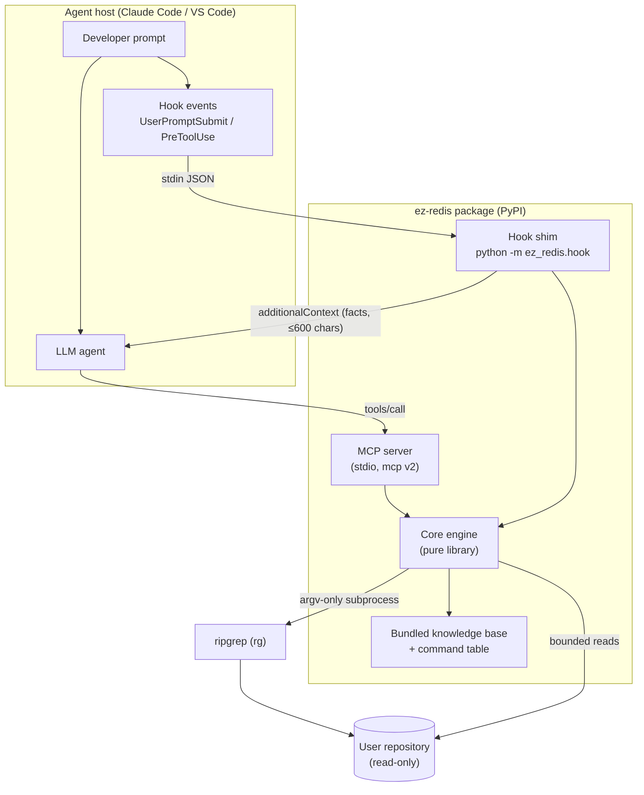
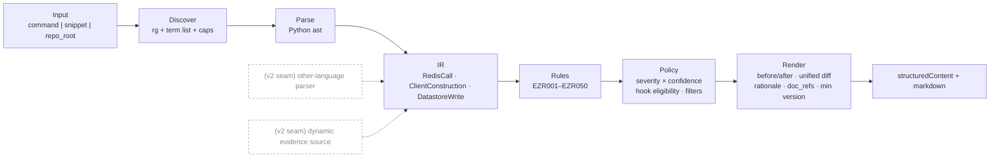
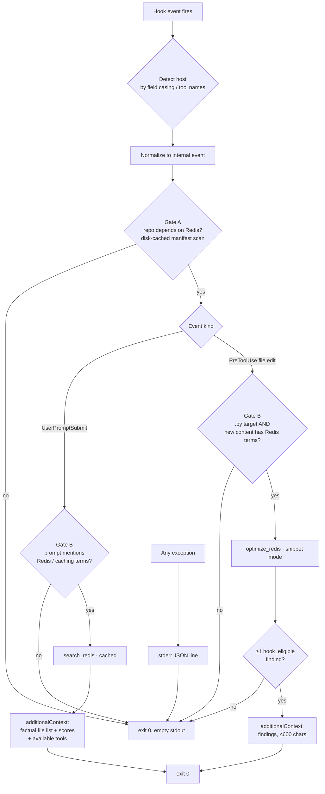
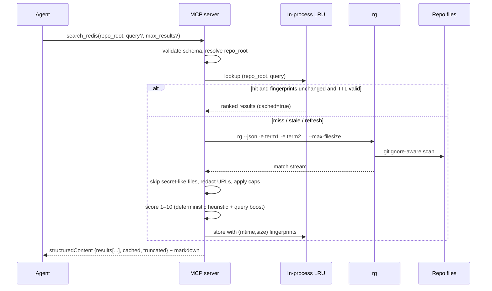
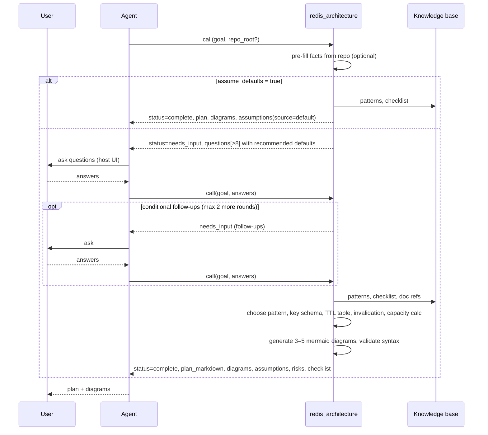
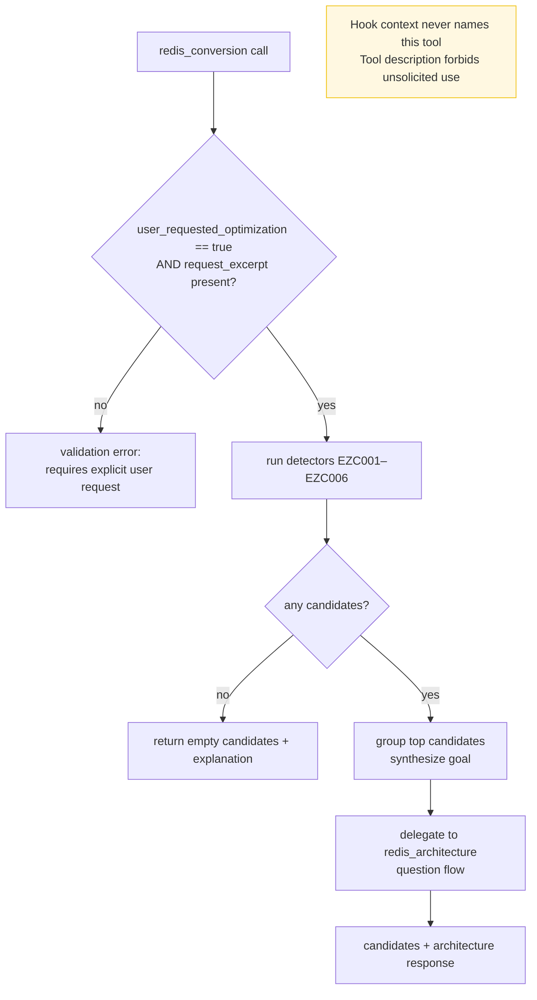
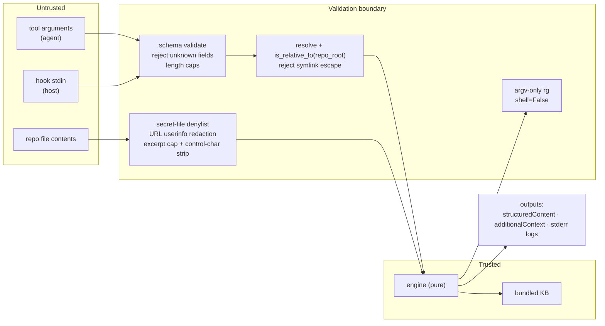
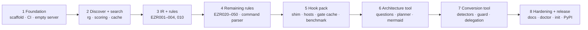

# ez-redis — Architecture Diagrams

Companion to `2026-09-01-ez-redis-mcp-server.md` (spec v1, **APPROVED 2026-09-01**). Every diagram reflects user-approved decisions D1–D34; nothing here introduces new requirements.

---

## 1. System context — two artifacts, one engine

Shows why ez-redis ships **two** deliverables (D1): the MCP server (model-invoked tools) and the hook pack (host-invoked shell shim). Both import the same pure engine library in-process (D17). The server never sees prompts; only hooks do (F1).



---

## 2. Core engine pipeline (simplified per D27)

The reference diagram's Dynamic Analysis, Evidence Fusion, and Change/Execution Manager were removed because v1 has no live Redis (D5) and never writes to the repo (D6). The **IR** is the documented seam for a future second language or dynamic evidence source.



---

## 3. Hook decision flow (D16, D3)

Both hooks are gated twice and fail open to silence. No `permissionDecision`, no `updatedInput`, ever.



---

## 4. `search_redis` sequence (D9, D10, D11)



---

## 5. `optimize_redis` — three entry modes

```mermaid
flowchart TD
    CALL[optimize_redis call] --> MODE{exactly one of\ncommand | snippet | repo_root}
    MODE -- none or >1 --> VERR[validation error]

    MODE -- command --> CP[redis-cli tokenizer]
    CP --> CT{in bundled\ncommand table?}
    CT -- no --> UNK[finding: unknown_command\nno suggestion]
    CT -- yes --> RULES

    MODE -- snippet --> AST1[ast.parse]
    AST1 -- SyntaxError --> UNP[finding: unparseable_file]
    AST1 -- ok --> IRB[build IR]

    MODE -- repo_root --> SR[search_redis · select files]
    SR --> AST2[ast.parse each file]
    AST2 --> IRB

    IRB --> RULES[apply EZR rules]
    RULES --> POL[policy: severity × confidence\nmin_* filters · hook_eligible]
    POL --> REN[render diff · rationale · doc_refs]
    REN --> OUT[structuredContent + markdown]
```

---

## 6. `redis_architecture` multi-round flow (D7, D23)

Agent-mediated questions; bounded to three rounds; `assume_defaults` short-circuits with every default recorded as an assumption.



---

## 7. `redis_conversion` guard and delegation (D21, D30)



---

## 8. Trust boundaries and data flow (security §13)



---

## 9. Delivery phases


